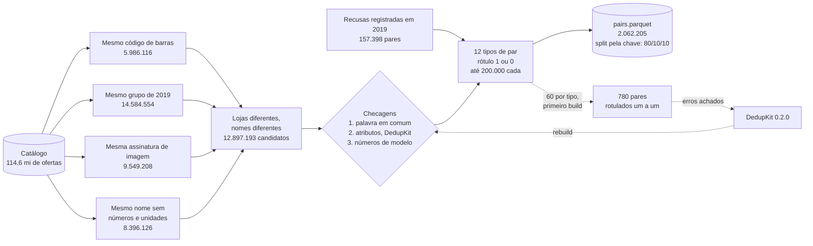
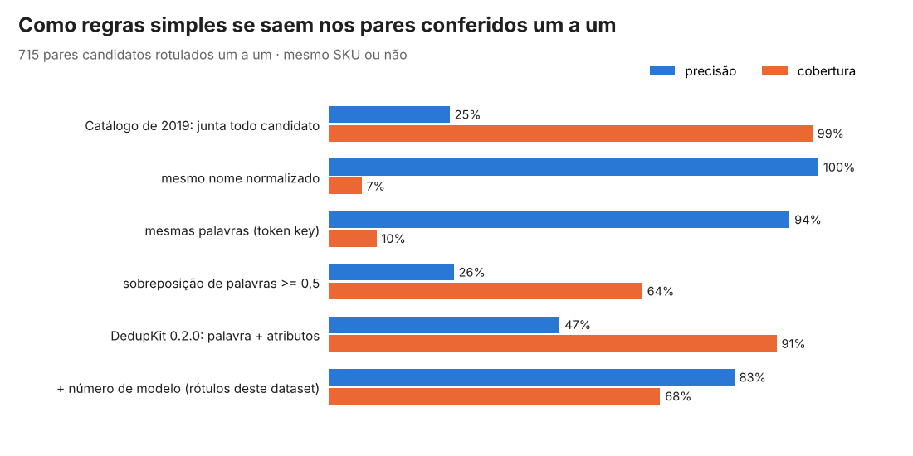
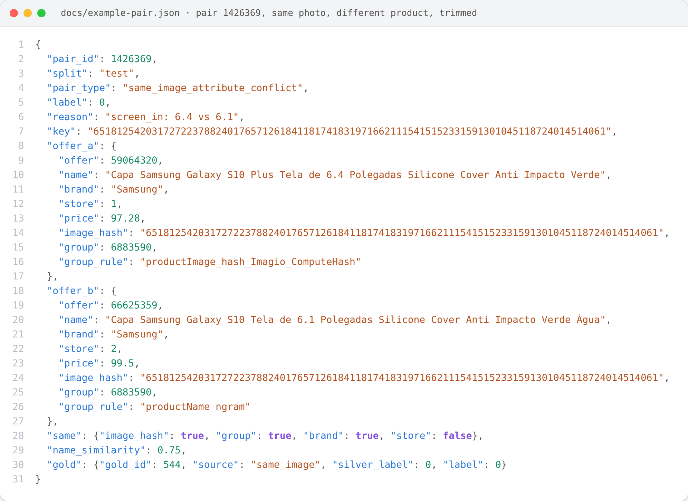

# Pares de produtos para matching (pt-BR)

[](https://github.com/CaiqueDourado/product-matching-pairs-portuguese/actions/workflows/validate.yml)
[](LICENSE-DATA.md)
[](LICENSE)
[](https://www.kaggle.com/datasets/caiquedourado/pares-matching-produtos-ptbr)

[Read in English](README.md)

**2.062.205 pares rotulados de ofertas de produtos de lojas brasileiras**, feitos para treinar e testar matching de
produtos (resolução de entidades) em português. Mais da metade são **negativos difíceis**: duas ofertas que dividem o código
de barras, a foto ou quase o nome inteiro e, mesmo assim, são produtos diferentes. **780 pares foram rotulados um a um**, para
que os métodos sejam avaliados contra uma referência que não vem das regras que montaram o resto.

| Mesmo EAN, mesmo produto | Mesmo EAN, produto diferente |
|---|---|
| Pilha de Zinco AAA Rayovac 4un. | Ferro a Vapor T-fal Fv1420 Rosa - **127v** |
| Pilha Rayovac Amarelinha Palito com 4 | Ferro a Vapor T-Fal FV1420 Rosa - **220V** |

| Mesma foto, produto diferente | Mesmo nome sem os números, produto diferente |
|---|---|
| Sapatilha com Fivela Usaflex - **35** - COCO | Shampoo Aussie Moist **865ML** |
| Sapatilha com Fivela Usaflex Coco - **34** - Coco | Shampoo Aussie Moist **180 Ml** |

As ofertas vêm do [catálogo de produtos do e-commerce brasileiro](https://github.com/CaiqueDourado/brazilian-ecommerce-products)
(114,6 milhões de ofertas, 2019–2024). Este repositório tem o script de montagem, a documentação, os 780 pares rotulados um a um e
uma amostra de 12.000 pares. **O dataset completo está no [Kaggle](https://www.kaggle.com/datasets/caiquedourado/pares-matching-produtos-ptbr).**

## O que é um par

Duas ofertas de **lojas diferentes** (com exceção de algumas recusas de 2019) e com **nomes diferentes**, que uma chave de
bloqueio colocou lado a lado: o mesmo código de barras, o mesmo grupo de produto de 2019, a mesma assinatura de imagem ou o
mesmo nome depois de tirar números e unidades. Cada candidato passa pelas conferências do
[DedupKit](https://github.com/CaiqueDourado/DedupKit) 0.2.0 (palavra em comum; tamanho, voltagem, cor, memória, tamanho de roupa,
quantidade, dimensões) e por uma conferência de número de modelo, e recebe um tipo e um rótulo:

| Tipo de par | Rótulo | Como foi feito | Pares | Rótulo certo nos pares conferidos |
|---|:---:|---|---:|---:|
| `same_code` | 1 | mesmo código de barras, nomes com palavra em comum, sem conflito de atributo ou modelo | 200.000 | 95% de 60 |
| `same_code_attribute_conflict` | 0 | mesmo código de barras, tamanho, voltagem, cor, quantidade... diferentes | 116.752 | 74% de 43 |
| `same_code_no_shared_word` | 0 | mesmo código de barras, nomes sem palavra em comum (a loja reaproveitou o código) | 81.179 | 98% de 60 |
| `same_group_name_rule` | 1 | mesmo grupo de produto de 2019 (por regra de nome ou URL), sem conflito | 200.000 | 66% de 44 |
| `same_group_attribute_conflict` | 0 | mesmo grupo de 2019, atributos diferentes | 200.000 | 99% de 76 |
| `same_group_model_conflict` | 0 | mesmo grupo de 2019, números de modelo diferentes (TB125 × TB112) | 200.000 | 89% de 47 |
| `same_image` | 1 | mesmo arquivo de imagem, sem conflito | 200.000 | 83% de 30 |
| `same_image_attribute_conflict` | 0 | mesmo arquivo de imagem, atributos diferentes (tamanhos de um calçado) | 200.000 | 99% de 96 |
| `same_image_model_conflict` | 0 | mesmo arquivo de imagem, números de modelo diferentes | 84.702 | 95% de 44 |
| `similar_name_attribute_conflict` | 0 | mesmo nome sem números e unidades, medidas diferentes | 200.000 | 100% de 67 |
| `similar_name_model_conflict` | 0 | mesmo nome sem números, modelos ou anos diferentes | 200.000 | 97% de 39 |
| `refused_2019` | 0 | casamento por código recusado pela rotina de 2019 (nomes sem palavra em comum) | 179.572 | 97% de 59 |

"Mesmo produto" quer dizer **o mesmo SKU**: o mesmo modelo no mesmo tamanho, cor, voltagem e embalagem. Dois tamanhos do
mesmo calçado são produtos diferentes aqui, porque têm códigos de barras diferentes.

Os rótulos de `pairs.parquet` são **aproximados (silver)**: vêm de regras. A última coluna diz quantas vezes cada regra acertou
nos pares rotulados um a um. Use os tipos com acerto alto para treinar como estão, pondere os outros e
**avalie os modelos nos pares rotulados um a um**.

## Como foi feito



Cada etapa, com contagens: [metodologia](docs/methodology.md) (em inglês).

## Os 780 pares rotulados um a um

[`gold/gold_pairs.csv`](gold/gold_pairs.csv): 60 pares de cada fonte de candidatos e resultado de regra de uma primeira
montagem (só da divisão de teste), lidos um a um e rotulados 1 (mesmo SKU), 0 (diferente) ou deixados em branco quando o
nome não diz o suficiente (65 pares). Os rótulos foram dados pelo Claude, um assistente de IA, seguindo regras escritas ([metodologia](docs/methodology.md#5-the-pairs-labelled-one-by-one)); não houve um segundo anotador. 164 são o mesmo produto e 551 não. A amostra foi estratificada por tipo, então tem mais
casos difíceis do que o normal: use-a para comparar métodos, não para estimar com que frequência as lojas reaproveitam códigos.

Como regras simples se saem neles ([`scripts/evaluate_gold.py`](scripts/evaluate_gold.py), [resultados](docs/gold-results.md)):

<p align="center"></p>

- O catálogo de 2019 juntava quase todo candidato: achava os pares certos, mas **3 em cada 4 junções estavam erradas** no nível
  de SKU, quase sempre tamanhos e cores de um modelo deixados na mesma página.
- Nomes iguais quase sempre acertam, mas acham menos de 1 em cada 10 pares: cada loja escreve o nome do seu jeito.
- As conferências de palavra e atributos do DedupKit dobram a precisão sem perder muitos pares; somando a conferência de número
  de modelo (TB125 × TB112, PS3 × PS4, Civic 2010 × 2011), ela chega a 83%.

## Para começar

```python
import duckdb
pares = "/kaggle/input/pares-matching-produtos-ptbr/pairs.parquet"   # ou sample/pairs_sample.csv
duckdb.sql(f"""
    SELECT split, pair_type, label, count(*) AS pares
    FROM '{pares}' GROUP BY ALL ORDER BY split, pair_type
""")
treino = duckdb.sql(f"SELECT name_a, name_b, label FROM '{pares}' WHERE split = 'train'").df()
```

A divisão em treino, validação e teste é feita por **cluster** (o código, grupo, imagem ou chave de nome que gerou o par), então
o mesmo código de barras ou grupo nunca aparece em duas divisões.

## Arquivos

| Arquivo | Linhas | Conteúdo |
|---|---:|---|
| `pairs.parquet` (Kaggle) | 2.062.205 | todos os pares, com nomes, marcas, lojas, preços, assinaturas de imagem, grupos de 2019 e divisão |
| `sample/pairs_sample.csv` | 12.000 | até 1.000 pares de cada tipo |
| `gold/gold_pairs.csv` | 780 | os pares rotulados um a um |
| `build_stats.json` | | contagens e parâmetros da montagem |

Cada coluna está no [dicionário de dados](docs/data-dictionary.pt-BR.md) ([English](docs/data-dictionary.md)).
Como os pares foram montados, passo a passo: [metodologia](docs/methodology.md) (em inglês).

## Como um par é estruturado



Um par de `sample/` em JSON aninhado: o par 1426369, duas capas de Samsung Galaxy S10 de lojas diferentes com a mesma assinatura de imagem e o mesmo grupo de 2019, rotulado 0 porque o tamanho da tela é diferente (6,4 × 6,1 polegadas). `same` mostra quais chaves das duas ofertas são iguais, e `gold` traz o rótulo que o par recebeu na conferência um a um. Registro completo: [docs/example-pair.json](docs/example-pair.json), gerado por [scripts/make_json.py](scripts/make_json.py).

## Limites

- Os rótulos aproximados vêm de regras sobre os nomes. Um par rotulado 1 ainda pode ser de dois produtos cujos nomes omitem o que muda.
- O nome só descreve o que a loja escreveu: um anúncio sem o tamanho casa com todos os tamanhos.
- Pares com nomes idênticos e pares da mesma loja ficaram de fora (são fáceis, ou o mesmo anúncio).
- As recusas de 2019 estão como a rotina antiga registrou. Cerca de metade pôde ser ligada às ofertas do catálogo; o resto tem só
  os nomes e o código.
- Preços e assinaturas de imagem estão como contexto. Não use a assinatura de imagem para prever os tipos `same_image*`: foi por
  ela que esses pares foram encontrados.

## Relacionados

- Artigo: [Metaphone, Soundex, n-gramas e MinHash em nomes de produtos brasileiros](https://github.com/CaiqueDourado/articles/blob/main/text-similarity/README.pt-BR.md) ([em inglês no Medium](https://medium.com/@caiquedourado/metaphone-soundex-n-grams-and-minhash-on-brazilian-product-names-d6f67745ee4d)): as chaves de agrupamento medidas nestes pares.
- [brazilian-ecommerce-products](https://github.com/CaiqueDourado/brazilian-ecommerce-products): o catálogo de onde vêm as ofertas ([Kaggle](https://www.kaggle.com/datasets/caiquedourado/catalogo-produtos-ecommerce-brasil)).
- [DedupKit](https://github.com/CaiqueDourado/DedupKit): as regras de matching usadas para tipar os pares, em Python e .NET. A conferência de atributos da versão 0.2.0 foi escrita a partir dos erros encontrados ao rotular estes pares.
- [SimilarImageFinder](https://github.com/CaiqueDourado/SimilarImageFinder): hashes perceptuais de imagem, para casar pela foto.
- [taxonomia-google-produtos-ptbr](https://github.com/CaiqueDourado/taxonomia-google-produtos-ptbr): a taxonomia de produtos do Google em português.

## Licença

- **Dados:** CC BY 4.0 ([LICENSE-DATA.md](LICENSE-DATA.md)).
- **Código:** MIT.
- Nomes de produto, marcas e preços são informação factual coletada em lojas e em feeds públicos de afiliados. Nenhuma imagem é distribuída.
