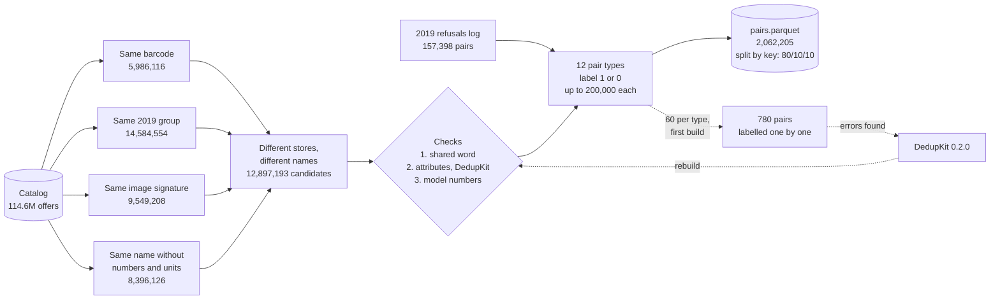

# Product matching pairs (pt-BR)

[](https://github.com/CaiqueDourado/pares-matching-produtos-ptbr/actions/workflows/validate.yml)
[](LICENSE-DATA.md)
[](LICENSE)
[](https://www.kaggle.com/datasets/caiquedourado/pares-matching-produtos-ptbr)

[Leia em português](README.pt-BR.md)

**{TOTAL} labelled pairs of product offers from Brazilian online stores**, built to train and test product matching
(entity resolution) in Portuguese. More than half are **hard negatives**: two offers that share a barcode, a photo or
almost the whole name, and are still different products. **780 pairs were labelled one by one**, so methods can be
scored against a reference that does not come from the rules that built the rest.

| Same barcode, same product | Same barcode, different product |
|---|---|
| Pilha de Zinco AAA Rayovac 4un. | Ferro a Vapor T-fal Fv1420 Rosa - **127v** |
| Pilha Rayovac Amarelinha Palito com 4 | Ferro a Vapor T-Fal FV1420 Rosa - **220V** |

| Same photo, different product | Same name without numbers, different product |
|---|---|
| Sapatilha com Fivela Usaflex - **35** - COCO | Shampoo Aussie Moist **865ML** |
| Sapatilha com Fivela Usaflex Coco - **34** - Coco | Shampoo Aussie Moist **180 Ml** |

The offers come from the [Brazilian e-commerce product catalog](https://github.com/CaiqueDourado/catalogo-produtos-ecommerce-brasil)
(114.6 million offers, 2019–2024). This repository has the build script, the documentation, the 780 pairs labelled one by one and a
sample of {SAMPLE} pairs. **The full dataset is on [Kaggle](https://www.kaggle.com/datasets/caiquedourado/pares-matching-produtos-ptbr).**

## What a pair is

Two offers, from **different stores** (except some 2019 refusals) and with **different names**, that a blocking key put
side by side: the same barcode, the same 2019 product group, the same image signature, or the same name once numbers
and units are removed. Each candidate is then checked with [DedupKit](https://github.com/CaiqueDourado/DedupKit) 0.2.0
(shared word; size, voltage, colour, memory, clothing size, pack quantity, dimensions) and a model-number check, and
gets a type and a label:

| Pair type | Label | How it was made | Pairs | Label right in the gold pairs |
|---|:---:|---|---:|---:|
{TYPE_TABLE}

"Same product" means **the same SKU**: the same model in the same size, colour, voltage and pack. Two sizes of the same
shoe are different products here, as they have different barcodes.

The labels in `pairs.parquet` are **silver**: they come from rules. The last column says how often each rule was right on
the pairs labelled one by one. Use the types with high agreement for training as they are, weigh the others, and
**score models on the gold pairs**.

## How it was built



Each step, with counts: [methodology](docs/methodology.md).

## The 780 pairs labelled one by one

[`gold/gold_pairs.csv`](gold/gold_pairs.csv): 60 pairs from each candidate source and rule outcome of a first build (test
split only), read one by one and labelled 1 (same SKU), 0 (different) or left empty when the name does not say enough
(65 pairs). The labels were assigned by Claude, an AI assistant, following written rules ([methodology](docs/methodology.md#5-the-pairs-labelled-one-by-one)); there was no second annotator. 164 are the same product and 551 are not. The sample was stratified by type, so it over-represents the hard
cases: use it to compare methods, not to estimate how often stores reuse barcodes.

How simple rules do on them ([`scripts/evaluate_gold.py`](scripts/evaluate_gold.py), [results](docs/gold-results.md)):

<p align="center"></p>

- The 2019 catalog merged almost every candidate: it found the real matches but **3 in 4 of its merges were wrong**
  at SKU level, mostly sizes and colours of one model kept on one product page.
- Equal names are almost always right, but find fewer than 1 in 10 matches: stores name products their own way.
- DedupKit's word and attribute checks double the precision without losing many matches; adding a model-number
  check (TB125 vs TB112, PS3 vs PS4, Civic 2010 vs 2011) brings it to 83%.

## Getting started

```python
import duckdb
pairs = "/kaggle/input/pares-matching-produtos-ptbr/pairs.parquet"   # or sample/pairs_sample.csv
duckdb.sql(f"""
    SELECT split, pair_type, label, count(*) AS pairs
    FROM '{pairs}' GROUP BY ALL ORDER BY split, pair_type
""")
train = duckdb.sql(f"SELECT name_a, name_b, label FROM '{pairs}' WHERE split = 'train'").df()
```

Splits are made by **cluster** (the barcode, group, image or name key that produced the pair), so the same barcode or
group never appears in two splits.

## Files

| File | Rows | Content |
|---|---:|---|
| `pairs.parquet` (Kaggle) | {TOTAL} | every pair, with names, brands, stores, prices, image signatures, 2019 groups and split |
| `sample/pairs_sample.csv` | {SAMPLE} | up to 1,000 pairs of each type |
| `gold/gold_pairs.csv` | 780 | the pairs labelled one by one |
| `build_stats.json` | | counts and build parameters |

Every column is described in the [data dictionary](docs/data-dictionary.md) ([português](docs/data-dictionary.pt-BR.md)).
How the pairs were built, step by step: [methodology](docs/methodology.md).

## Limits

- The silver labels come from rules on the names. A pair labelled 1 can still be two products whose names omit what differs.
- Names only describe what the store wrote: a listing without the size matches every size.
- Pairs with identical names and pairs from the same store were left out (they are easy, or the same listing).
- 2019 refusals are kept as the old routine logged them. About half could be linked back to offers in the catalog;
  the rest have only names and the barcode.
- Prices and image signatures are given as context. Do not use the image signature as a feature to predict the
  `same_image*` types: it is how those pairs were found.

## Related

- [catalogo-produtos-ecommerce-brasil](https://github.com/CaiqueDourado/catalogo-produtos-ecommerce-brasil): the catalog these offers come from ([Kaggle](https://www.kaggle.com/datasets/caiquedourado/catalogo-produtos-ecommerce-brasil)).
- [DedupKit](https://github.com/CaiqueDourado/DedupKit): the matching rules used to type the pairs, in Python and .NET. Its 0.2.0 attribute check was written from the errors found while labelling these pairs.
- [SimilarImageFinder](https://github.com/CaiqueDourado/SimilarImageFinder): perceptual image hashes, for matching by photo.
- [taxonomia-google-produtos-ptbr](https://github.com/CaiqueDourado/taxonomia-google-produtos-ptbr): Google's product taxonomy in Portuguese.

## License

- **Data:** CC BY 4.0 ([LICENSE-DATA.md](LICENSE-DATA.md)).
- **Code:** MIT.
- Product names, brands and prices are factual information collected from stores and public affiliate feeds. No images are distributed.
